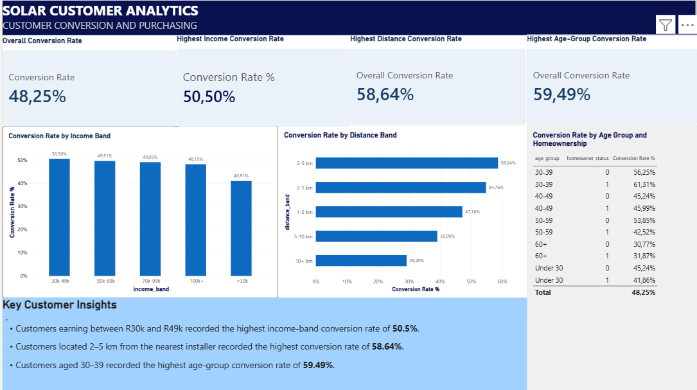

# Solar Customer Analysis

## Table of Contents

- [Project Overview](#Project-Overview)
- [Data Sources ](#Data-Sources )
- [Tools](#Tools)
- [Data Preparation](#Data-Preparation)
- [Exploratory Data Analysis](#Exploratory-Data-Analysis)
- [SQL Analysis](#SQL-Analysis)
- [1.Overall Solar Purchasing Behaviour](##1.Overall-Solar-Purchasing-Behaviour)
- [2.Customer Age Segmentation](##2.Customer-Age-Segmentation)
- [3.Regional Purchasing Analysis](##3.Regional-Purchasing-Analysis)
- [4.Installer Distance and Purchasing Behaviour](##4.Installer-Distance-and-Purchasing-Behaviour)
- [5.Income Analysis by Education Level](##5.Income-Analysis-by-Education-Level)
- [Key Findings](#Key-Findings)
- [Dashboard Preview](#Dashboard-Preview)
- [Recommendations](#Recommendations)
- [Limitations](#Limitations)
- [Conclusion](#Conclusion)

## Project Overview
This project analyses solar customer data to identify purchasing patterns and trends across income levels, age groups and installer distance.

### Data Sources 
The primary dataset used for this analysis is the "SunVolt_Solar_Customer_Data.csv" file.

### Tools

- Microsoft Excel - Source data for analysis and reviewing
- SQL Server Management Studio (SSMS) - Data Analysis
- Microsoft Power BI - Creating reports, dashboards and providing key indicators

 ### Data Preparation
 In the initial data preparation phase, the following tasks were performed:
 1. Data inspection and validation
 2. Data type correction
 3. Data standardisation
 4. Database preparation and structuring
 5. Record count verification
 
 ### Exploratory Data Analysis
 EDA involved exploring the solar customers' data to answer key questions, such as:

 - What are the demographic characteristics of solar customers?
 - Which age and income groups show the highest purchasing activity?
 - How does installer distance relate to solar purchasing behaviour?
 - What patterns and trends can be identified in customer purchasing behaviour?
 
 ### SQL Analysis
#### 1.Overall Solar Purchasing Behaviour
```sql
SELECT
      COUNT(*) AS customers,
      SUM(CASE WHEN Purchase_Flag = 1 THEN 1 ELSE 0) AS purchases,
      CAST(
           SUM(CASE WHEN Purchase_Flag = 1 THEN 1 ELSE 0 END)
           * 100.0/ COUNT(*) decimals(5,2)
      ) AS conversion_pct
FROM SunVolt_Customer_Date;
```

####  2.Customer Age Segmentation
```sql

SELECT
    CASE
        WHEN Age < 40 THEN 'Under 40'
        WHEN Age BETWEEN 40 AND 59 THEN '40-59'
        ELSE '60+'
    END AS age_segment,
    COUNT(*) AS customers,
    SUM(CASE WHEN Purchase_Flag = 1 THEN 1 ELSE 0 END) AS purchases,
    CAST(
        SUM(CASE WHEN Purchase_Flag = 1 THEN 1 ELSE 0 END)
        * 100.00 / COUNT(*)
        AS DECIMAL(5,2)
    ) AS conversion_pct
FROM SunVolt.dbo.SunVolt_Solar_Customer_Data
GROUP BY
    CASE
        WHEN Age < 40 THEN 'Under 40'
        WHEN Age BETWEEN 40 AND 59 THEN '40-59'
        ELSE '60+'
    END
ORDER BY age_segment ASC;
```

#### 3.Regional Purchasing Analysis
```sql
SELECT
    Region,
    COUNT(*) AS customers,
    SUM(CASE WHEN Purchase_Flag = 1 THEN 1 ELSE 0 END) AS Purchases,
    CAST(
        SUM(CASE WHEN Purchase_Flag = 1 THEN 1 ELSE 0 END)
        * 100.00 / COUNT(*) AS DECIMAL(5,2)
    ) AS conversion_pct
FROM SunVolt_Solar_Customer_Data
GROUP BY Region
ORDER BY conversion_pct DESC;
```

#### 4. Installer Distance and Purchasing Behaviour
```sql
SELECT
    distance_bands.installer_distance_order,
    COUNT(*) AS customers,
    SUM(CASE
        WHEN SunVolt_Solar_Customer_Data.Purchase_Flag = 1
        THEN 1 ELSE 0
    END) AS purchases
FROM SunVolt.dbo.SunVolt_Solar_Customer_Data
INNER JOIN SunVolt.dbo.distance_bands
ON SunVolt_Solar_Customer_Data.Distance_from_Nearest_Installer =
   distance_bands.distance_band
GROUP BY distance_bands.installer_distance_order
ORDER BY distance_bands.installer_distance_order ASC;
```

#### 5.Income Analysis by Education Level
```sql
SELECT
    Education_Level,
    COUNT(*) AS customers,
    ROUND(
        AVG(TRY_CONVERT(FLOAT, REPLACE(Annual_Income, ' ', ''))),
        0
    ) AS avg_income
FROM SunVolt_Solar_Customer_Data
GROUP BY Education_Level
HAVING COUNT(*) >= 100
ORDER BY avg_income DESC;
```

### Key Findings
  The analysis of 1026 customer records revealed several patterns in solar system adaptation:
- The overall conversion rate was 48.25% revealing that less than half of the customers in the dataset purchased a solar system
- Customers earning between R30 000 and R49 000 recorded a conversion rate of 50.50%, marking them as an important segment for understanding solar adoption.
- Customers aged between 30-39 had the highest conversion rate, recorded at 59.49%. In comparison customers aged 60 and above recorded the lowest conversion rate at 31.62%. This shows that customers who are aged between 30-39 were more likely to purchase solar systems.
- Customers located between 2-5 km from the nearest installer, recorded a conversion rate of 58.64%, higlighting this distance category as an important segment in the analysis


### Dashboard Preview

 

 ### Recommendations

- Prioritise the high converting age group (59.49%) through focused marketing campaigns and solar energy promotions.
- Introduce affordable payment plans to attract customers earning between R30 000-R49 000, who recporded a 50.50% conversion rate.
- Investigate installer coverage  and service availability in araeas where customers aree located 2-5 km from the nearest installer, which recorded a 58.64% conversion rate.
- Investigate why customers aged 60 and above have a lower conversion rate (31.62%) and consider targeted educational campaigns and suitable payment options.
- Use the Poer BI dashboard to track customer conversion trends across income, age, homeowner status and installer distance to support ongoing business decisions 

### Limitations
- The original dataset contained inconsistent data formats and values that required cleaning and conversion before analysis
- SeveralSQL import errors occured due to mismatched data types
- The dataset did not provide sufficient information to establish lthe exact reasons behind cutsomers' purchasing decisions 

  
### Conclusion
This customer records, established an overall solar system conversion rate of 48.25%. The analysis identified important differences in purchasing behaviour across customer income groups, age categories and distances from the nearest solar installer.
The findings showed that customers aged 30-39 had the highest conversion rate at 59.49%, while customers earning between R30 000 and R49 000 recorded a conversion rate of 50.50%. In addition, customers located 2-5 km from the nearest installer also demonstrated a relatively high conversion rate of 58.64%. These results helped identify customer segments with stronger solar purchasing potential.

From a business perspective, these insights can support more focused marketing strategies and better informed decisions about customer acquisitions.This allows for a proper understanding of how demographic and geographical factors relate to purchasing behaviour.

Overall, the project demonstrated the role of data analytics in translating raw information into actionable insights that can support business decision making.
